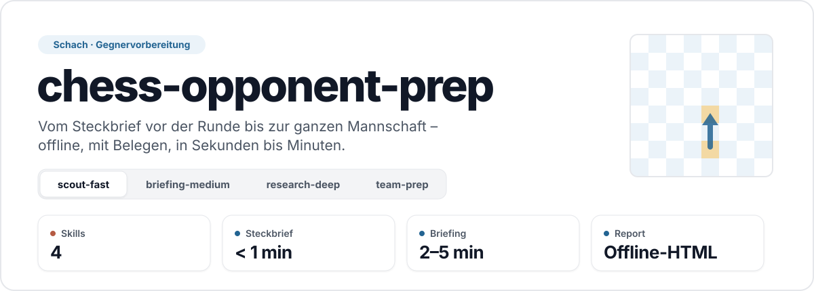
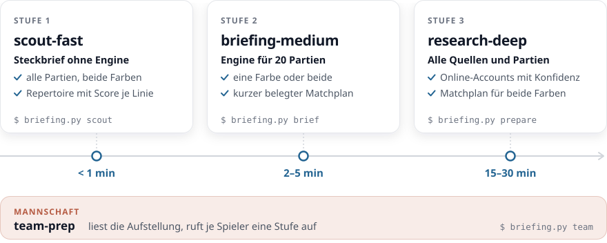

<picture>
  <source media="(prefers-color-scheme: dark)" srcset="docs/assets/header-dark.svg">
  
</picture>

<p align="center"><sub>Python 3.12+ · Stockfish · Windows, macOS, Linux · offline · Apache-2.0</sub></p>

Aus FIDE-ID, Name oder ChessBase-Link wird eine **offline lauffähige HTML-Seite** zur Vorbereitung auf einen Gegner –
oder auf eine ganze Mannschaft. Alles Rechnen macht `briefing.py` (Stockfish, Kennzahlen, Belege); ein KI-Agent
schreibt höchstens den Matchplan, und jede Zahl darin ist mit einem Beleg verknüpft.

## Die vier Skills

<picture>
  <source media="(prefers-color-scheme: dark)" srcset="docs/assets/skills-dark.svg">
  
</picture>

| Skill | Wann | Dauer* | Ergebnis |
|---|---|---|---|
| [**scout-fast**](skills/chess-opponent-scout-fast/SKILL.md) | kurz vor der Runde | < 1 min | Steckbrief: alle Partien beider Farben, Repertoire mit Score je Linie, Form, Partien-Viewer – ohne Engine |
| [**briefing-medium**](skills/chess-opponent-briefing-medium/SKILL.md) | Vorbereitung auf eine Partie | 2–5 min | Engine für die 20 jüngsten Partien (eine Farbe oder je 10 bei beiden), Spielerprofil, kurzer Matchplan |
| [**research-deep**](skills/chess-opponent-research-deep/SKILL.md) | gründliche Recherche | 15–30 min | alle Quellen und Partien, Online-Accounts (mit Konfidenz), Profil, Matchplan für beide Farben |
| [**team-prep**](skills/chess-opponent-team-prep/SKILL.md) | ganze Mannschaft | Stufe × Spieler | liest die Aufstellung, ruft je Spieler eine der drei Stufen auf, eine Seite mit Spielerauswahl |

<sub>* gemessen bei Erstkontakt mit leerem Cache, einschließlich Laden der ChessBase-Partien (8 Kerne).</sub>

## Schnellstart

```bash
python -m pip install -r requirements.txt
python briefing.py setup       # Stockfish (offizielles Release) nach tools/
python briefing.py doctor      # Umgebung prüfen
python briefing.py selftest    # Offline-Tests
```

Python ≥ 3.12 · Windows, macOS, Linux · kein Login, kein API-Schlüssel.

## Mit einem KI-Agenten (empfohlen)

Ordner in Claude Code, Codex oder Gemini CLI öffnen und schreiben – der Agent wählt den Skill über [AGENTS.md](AGENTS.md):

> „Schneller Check zu Max Mustermann, ich habe Weiß.“ → **scout-fast**
> „Bereite mich auf Max Mustermann vor, beide Farben.“ → **briefing-medium**
> „Ausführliche Recherche zu FIDE 1503014.“ → **research-deep**
> „Bereite die Mannschaft vor: `<Link zur Mannschaftsseite>`, Bretter 101–108, Stufe scout.“ → **team-prep**

## Von Hand

```bash
python briefing.py scout   "<FIDE-ID | Name | Link>" --color white|black|both
python briefing.py brief   "<FIDE-ID | Name | Link>" --color white|black|both     # danach Matchplan schreiben
python briefing.py prepare "<FIDE-ID | Name | Link>"                               # research-deep
python briefing.py team    "<Mannschaftsseite | team.json | Spieler …>" --stage scout|medium|research --boards 101-108
```

- `--color` ist immer **deine** Farbe; `both` betrachtet beide.
- `--budget <Sekunden>` setzt die Zeitgrenze von scout und brief – das Programm hält sie selbst ein.
- **ChessBase-Partien:** `python briefing.py receive "<Spieler>"` starten und den ausgegebenen Befehl auf der
  ChessBase-Profilseite im Browser ausführen. Die PGN landet ohne Dialog in `output/players/<slug>/inbox/` und wird
  danach von allen Stufen wiederverwendet (Hinweis zum Neuladen nach 7 Tagen). Bot-Prüfungen werden nie umgangen.
- Mannschaftsseiten von Ligaservern (z. B. nsv-online.de) liest `team` selbst; für andere Seiten schreibt der Agent eine `team.json`.

## Ergebnisse

```
output/
├── players/<slug>/   scout_<slug>.html · briefing_<slug>_beide.html · briefing_<slug>.html · Daten, inbox/
└── teams/<team>/     team_<team>_<stufe>.html
```

Jede Seite ist eine einzelne HTML-Datei (hell/dunkel, mobil): Eröffnungsbaum zum Durchklicken, Partien-Viewer,
Schlüsselstellungen, Fehlerbild je Phase, Bedenkzeit, Spielerprofil. `output/`, `cache/` und `.env` bleiben lokal
und gehören nicht ins Repository.

## Aufbau

| Pfad | Inhalt |
|---|---|
| `briefing.py` | Kommandozeile |
| `chess_briefing/` | Pipeline – `modes/` (scout, medium, team), `pipeline.py` (research), `sources/`, `online/`, `render/` |
| `skills/` | die vier modellunabhängigen Skills, Referenzen unter `chess-opponent-research-deep/references/` |
| `.claude/skills/` | Verweise für die automatische Skill-Erkennung in Claude Code |
| `tests/` | Offline-Tests (`python briefing.py selftest`) |

Details: [architecture.md](skills/chess-opponent-research-deep/references/architecture.md) ·
Datenquellen und Grenzen: [data-sources.md](skills/chess-opponent-research-deep/references/data-sources.md)

## Lizenz und Quellen

Apache-2.0 ([LICENSE](LICENSE)). Aufbauend auf Struktur und Kennzahlen von chessimprovement/opponent-prep, neu
implementiert. Stockfish (GPL) lädt `setup` vom offiziellen Release; Figuren von Colin M. L. Burnett (GPL/CC BY-SA)
über python-chess; Eröffnungsnamen von lichess-org/chess-openings (CC0). Die README-Grafiken betten Teile der Schrift
[Manrope](https://github.com/sharanda/manrope) ein (© 2019 The Manrope Project Authors,
[SIL Open Font License 1.1](https://openfontlicense.org)); erzeugt mit `docs/assets/make_readme_art.py`.
